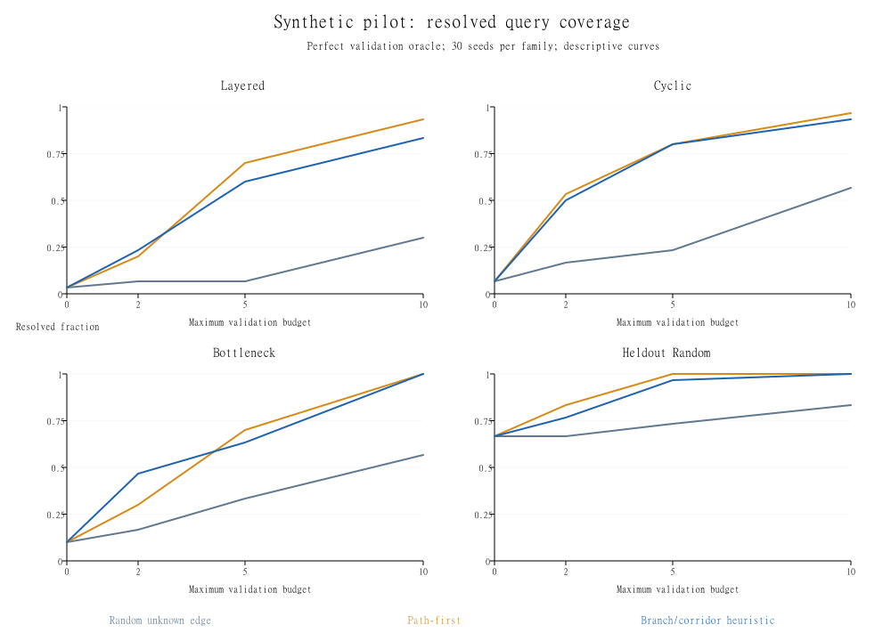

# Exploratory synthetic pilot results

Generated by the included benchmark, not invented observations. This pilot is exploratory and uses a perfect unit-cost validation oracle with sparse correct initial trusted evidence. It does not evaluate live assessment efficacy.

120 candidate graphs; four topology families; 30 seeds per family; five methods; budgets 0/2/5/10; 2,400 raw method rows. The two observation-only baselines perform no validation regardless of the displayed budget. Planning methods can stop before reaching the budget.

## Budget 5: all-family descriptive aggregate

This aggregate is shown for orientation. Per-family results and paired intervals are in the raw summary; the rows are not independent across budgets/methods.

| Method | False-safe rate | False-confirmed rate | Resolved coverage | Mean declared loss | Mean validations used |
|---|---:|---:|---:|---:|---:|
| optimistic | 0.3333 | 0.0167 | 1.0000 | 3.3833 | 0.0000 |
| two_origins | 0.3667 | 0.0000 | 1.0000 | 3.6667 | 0.0000 |
| bounds_random | 0.0000 | 0.0000 | 0.3417 | 0.6583 | 3.7000 |
| bounds_path_first | 0.0000 | 0.0000 | 0.8000 | 0.2000 | 2.7417 |
| bounds_gain | 0.0000 | 0.0000 | 0.7500 | 0.2500 | 2.5667 |

## Interpretation

The proposed bounds_gain heuristic did **not** outperform the stronger path-first baseline on this aggregate: coverage was 0.75 versus 0.80 at budget 5, and declared loss was 0.25 versus 0.20. It used slightly fewer validations on average, which is a tradeoff rather than demonstrated superiority. Preserve this negative finding. None of the four per-family budget-5 comparisons establishes a clear advantage over path-first under the pointwise intervals below.

All bounds methods produced zero false-safe and false-confirmed decisions under the pilot's correctness assumptions. That is expected from the containment model and perfect validation, not empirical evidence of robustness to incorrect trusted validators or omitted true transitions. Observation-only methods often treated missing transitions as absent and therefore made false-safe decisions in this synthetic setup. Their lower information/cost budget makes them contextual baselines, not fair competitors to a validation planner.

## Budget 5: paired loss differences by family

Difference is bounds_gain minus baseline; negative favors bounds_gain. Intervals are pointwise 95% paired percentile bootstrap over 30 seeds with 1,000 resamples. No multiplicity adjustment or confirmatory significance claim.

| Family | Baseline | Mean paired loss difference | Pointwise interval |
|---|---|---:|---|
| bottleneck | bounds_random | -0.3000 | [-0.5000, -0.1000] |
| bottleneck | bounds_path_first | 0.0667 | [-0.1000, 0.2333] |
| cyclic | bounds_random | -0.5667 | [-0.7667, -0.3667] |
| cyclic | bounds_path_first | 0.0000 | [-0.1333, 0.1333] |
| heldout_random | bounds_random | -0.2333 | [-0.4000, -0.1000] |
| heldout_random | bounds_path_first | 0.0333 | [0.0000, 0.1000] |
| layered | bounds_random | -0.5333 | [-0.7000, -0.3667] |
| layered | bounds_path_first | 0.1000 | [-0.1000, 0.3333] |

## What to do next

Use path-first as a serious baseline. Investigate graph families where the heuristic wastes effort, add actual validation costs and imperfect outcomes, compare to exact small-instance planning, and separate exploratory tuning from a frozen held-out evaluation. Do not rename the baseline, remove difficult seeds, or select a favorable budget to create a superiority claim.

See PROTOCOL.md for the full caveats and MODEL.md for the conditional guarantee. Raw graph fixtures, truth labels, rows, summaries, and integrity hashes are in pilot-results.zip. Runtime is a local measurement and changes across runs; semantic outcomes should reproduce from the same code/seeds.

